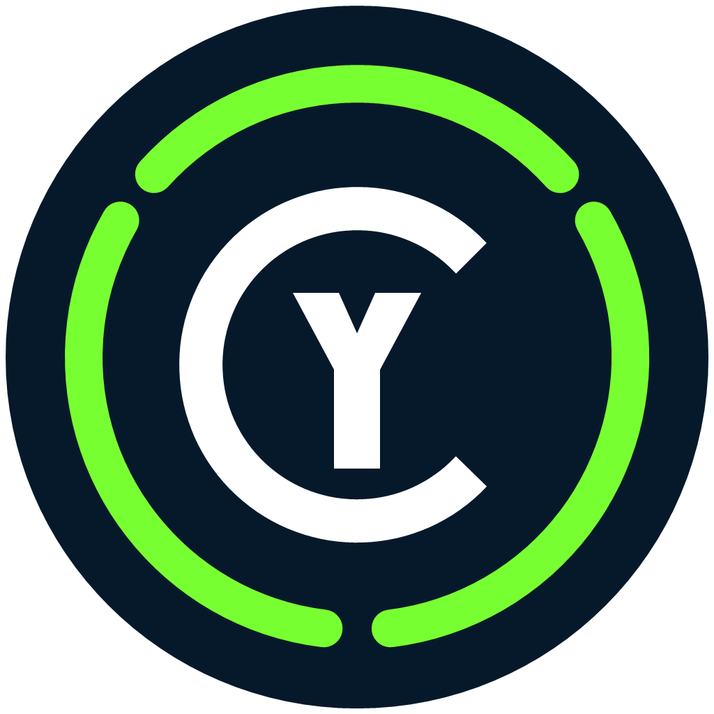

<table width="100%" border="1" cellspacing="0" cellpadding="10">
  <tr>
    <td width="33%" valign="top">
      <strong>Liens</strong><br><br>
      <a href="https://mrmybal.github.io/CyCapture/Documentation.html#/fr/getting-started">Documentation</a><br>
      <a href="https://github.com/MrMybal/CyCapture">Dépôt</a><br>
      <a href="https://github.com/MrMybal/CyCapture/issues">Problèmes</a><br><br>
      <strong>Langue</strong><br><br>
      <a href="README.md">English</a> · <strong>Français</strong>
    </td>
    <td width="34%" align="center" valign="middle">
      <a href="https://mrmybal.github.io/CyCapture/Documentation.html#/fr/getting-started">
        
      </a>
    </td>
    <td width="33%" valign="top">
      <strong>Licence de l’application</strong><br>
      <a href="LICENSE">GNU AGPL-3.0-only</a><br><br>
      <strong>Version</strong><br>
      <a href="VERSION.fr.md">1.4.11</a><br>
      <strong>BÊTA</strong><br><br>
      <strong>Téléchargement</strong><br>
      <a href="https://github.com/MrMybal/CyCapture/releases/download/v1.4.11/CyCapture-1.4.11-windows-x64-installer.exe">Installateur Windows x64</a>
    </td>
  </tr>
</table>

<h1 align="center">CyCapture</h1>
<p align="center">Par <a href="https://github.com/MrMybal">CyberAlien</a></p>

CyCapture est une application de capture Windows discrète, pensée pour fonctionner depuis la zone de notification et remplacer le flux de travail habituel de la touche Impr écran par la capture d’image, de vidéo, de GIF et d’audio.

La version **1.4.11** est actuellement en **bêta**. Consultez les [notes de version](VERSION.fr.md) pour connaître le périmètre actuel et les limites connues.

## À propos de CyCapture

Lancez CyCapture une fois : l’application reste ensuite disponible dans la zone de notification Windows. Appuyez sur Impr écran pour ouvrir la palette de capture, démarrer directement une action ou utiliser le comportement hybride configurable : un appui court lance la sélection intelligente d’image et un appui prolongé ouvre la palette des modes.

Le sélecteur visuel peut cibler une fenêtre visible, un écran ou une zone libre sur plusieurs moniteurs. Un nouvel appui sur Impr écran arrête une capture vidéo, GIF ou audio en cours. Les images peuvent également être annotées directement sur le bureau figé avant de choisir la zone finale.

Les médias capturés sont disponibles dans la galerie intégrée et peuvent être copiés dans le presse-papiers. Le système de plugins prend en charge les traitements après capture. Le paquet Windows complet peut inclure l’intégration facultative de [CyAnnota](https://github.com/MrMybal/CyAnnota) ; CyAnnota reste un projet séparé et son plugin est désactivé par défaut.

Le guide illustré complet est disponible dans la [documentation française](https://mrmybal.github.io/CyCapture/Documentation.html#/fr/getting-started).

## Fonctionnalités

- Modes de capture d’image, de vidéo, de GIF animé et d’audio seul.
- Sélection intelligente des fenêtres visibles tenant compte de leur ordre et de leur occlusion.
- Capture d’écran entier et de zone libre sur les bureaux à plusieurs moniteurs.
- Annotations rapides sur le bureau figé : dessin libre, cadres, flèches et texte.
- Réglages indépendants pour l’image, la vidéo, le GIF, l’audio, la fréquence d’images, le débit et la qualité.
- Fonctionnement dans la zone de notification, gestion globale d’Impr écran, raccourcis de modes directs et état d’enregistrement.
- Galerie multimédia avec aperçu des images, GIF, vidéos et sons, filtres par date et actions de presse-papiers.
- Dossiers configurables, classement par type et par jour, métadonnées intégrées ou séparées et intégration au presse-papiers.
- Découverte et configuration de plugins C#, dont le post-traitement facultatif avec CyAnnota.
- Documentation CyDoc bilingue, consultable, entièrement locale, avec schémas et aide contextuelle.

---

## Installation

CyCapture cible actuellement **Windows x64**. Les éditions Windows N et KN peuvent nécessiter le Media Feature Pack de Microsoft pour la lecture vidéo.

### Recommandé : installateur

Téléchargez puis exécutez [CyCapture 1.4.11 pour Windows x64](https://github.com/MrMybal/CyCapture/releases/download/v1.4.11/CyCapture-1.4.11-windows-x64-installer.exe). L’installateur enregistre l’application, les raccourcis du menu Démarrer, la désinstallation et les composants facultatifs sélectionnés.

### Éditions portables

- [Édition portable avec CyAnnota](https://github.com/MrMybal/CyCapture/releases/download/v1.4.11/CyCapture-1.4.11-windows-x64-portable.exe)
- [Édition portable sans CyAnnota](https://github.com/MrMybal/CyCapture/releases/download/v1.4.11/CyCapture-1.4.11-windows-x64-portable-without-CyAnnota.exe)
- [Paquet du plugin CyAnnota](https://github.com/MrMybal/CyCapture/releases/download/v1.4.11/CyCapture.Plugin.CyAnnota-0.4.4.zip)

Extrayez une archive portable dans un dossier accessible en écriture, puis lancez `CyCapture.exe`. Les binaires de l’application sont autonomes. L’aide hors ligne est distribuée avec l’application et peut également utiliser sa copie embarquée de secours.

<details>
<summary><strong>Compiler depuis les sources</strong></summary>

### Prérequis

- SDK .NET 8 ou plus récent.
- Node.js 22 et npm pour l’export de la documentation CyDoc.
- Git.
- Inno Setup 6 uniquement pour construire l’installateur Windows.
- Un exécutable portable CyAnnota uniquement lors de la création explicite du paquet complet.

CyDoc est une dépendance de compilation publique et épinglée. Son lecteur exporté et ses ressources sont copiés dans CyCapture afin que la documentation installée reste disponible hors ligne par une URL locale `file://`.

### Commandes

```powershell
git clone https://github.com/MrMybal/CyCapture.git
cd CyCapture
dotnet restore CyCapture.sln --runtime win-x64
dotnet build CyCapture.sln -c Release
dotnet run --project tests/CyCapture.SettingsChecks/CyCapture.SettingsChecks.csproj -c Release -- .
./scripts/build-documentation.ps1
```

Pour produire le paquet Windows complet, indiquez explicitement le chemin de CyAnnota :

```powershell
./scripts/publish-windows-local.ps1 -CyAnnotaSource "C:\chemin\vers\CyAnnota-0.4.4-portable.exe"
```

</details>

---

## Licence et composants tiers

CyCapture est distribué sous la [GNU Affero General Public License v3.0 uniquement](LICENSE). Copyright © CyberAlien.

| Composant | Version | Licence | Utilisation dans CyCapture |
|---|---:|---|---|
| Avalonia | 12.1.1 | MIT | Cadriciel d’interface multiplateforme de l’application |
| Environnement .NET | 8 | MIT et notices des composants | Environnement autonome de l’application |
| ScreenRecorderLib | 6.6.0 | MIT | Enregistrement de l’écran et de la vidéo sous Windows |
| NAudio | 2.3.0 | MIT | Capture et traitement audio sous Windows |
| LibVLCSharp / LibVLC | 3.10.1 / 3.0.23.1 | Composants LGPL-2.1-or-later | Lecture vidéo et audio dans la galerie |
| System.Drawing.Common | 8.0.20 | MIT | Interopérabilité des images sous Windows |
| CyDoc | 0.1.0 | MIT | Export lors de la compilation et lecteur local ; modules image et galerie uniquement |
| CyAnnota | 0.4.4 | AGPL-3.0-only | Post-édition facultative dans les paquets complet et plugin |

Consultez [BUNDLED_COMPONENTS.md](BUNDLED_COMPONENTS.md) pour les détails de distribution et les références des sources.

## Références

- [Manuel français](https://mrmybal.github.io/CyCapture/Documentation.html#/fr/getting-started)
- [English manual](https://mrmybal.github.io/CyCapture/Documentation.html#/en/getting-started)
- [Versions et téléchargements](https://github.com/MrMybal/CyCapture/releases)
- [Suivi des problèmes](https://github.com/MrMybal/CyCapture/issues)
- [API des plugins](PLUGIN_API.md)
- [Composants distribués](BUNDLED_COMPONENTS.md)
- [CyAnnota](https://github.com/MrMybal/CyAnnota)
- [CyDoc](https://github.com/MrMybal/CyDoc)
