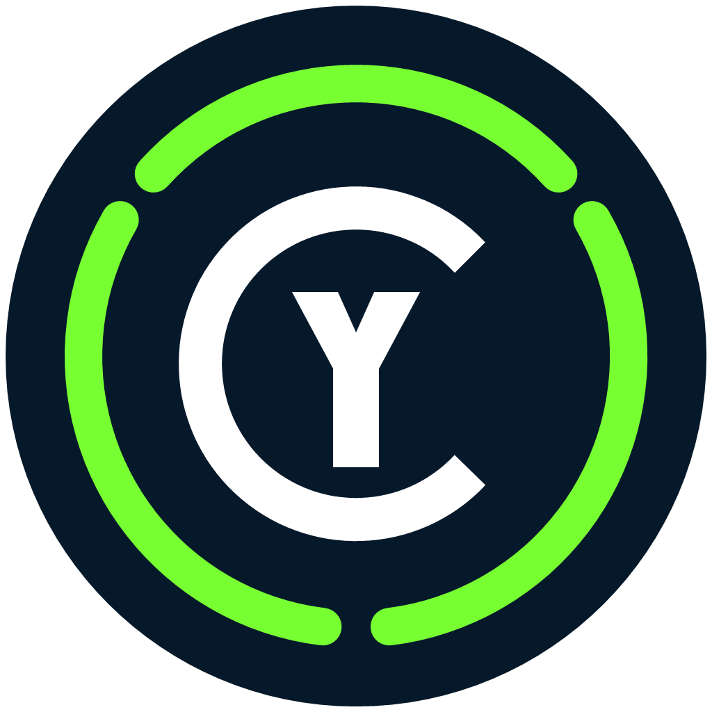

# CyCapture

<table width="100%" border="1" cellspacing="0" cellpadding="10">
  <tr>
    <td width="33%" valign="top">
      <strong>Links</strong><br><br>
      <a href="https://mrmybal.github.io/CyCapture/Documentation.html#/en/getting-started">Documentation</a><br>
      <a href="https://github.com/MrMybal/CyCapture">Repository</a><br>
      <a href="https://github.com/MrMybal/CyCapture/issues">Issues</a><br><br>
      <strong>Language</strong><br><br>
      <strong>English</strong> · <a href="README.fr.md">Français</a>
    </td>
    <td width="34%" align="center" valign="middle">
      <a href="https://mrmybal.github.io/CyCapture/Documentation.html#/en/getting-started">
        
      </a>
    </td>
    <td width="33%" valign="top">
      <strong>Application license</strong><br>
      <a href="LICENSE">GNU AGPL-3.0-only</a><br><br>
      <strong>Version</strong><br>
      <a href="VERSION.md">1.4.11</a><br>
      <strong>BETA</strong><br><br>
      <strong>Download</strong><br>
      <a href="https://github.com/MrMybal/CyCapture/releases/download/v1.4.11/CyCapture-1.4.11-windows-x64-installer.exe">Windows x64 installer</a>
    </td>
  </tr>
</table>

<h1 align="center">CyCapture</h1>
<p align="center">By <a href="https://github.com/MrMybal">CyberAlien</a></p>

CyCapture is a discreet, tray-first Windows capture application that replaces the usual Print Screen workflow with image, video, GIF, and audio capture.

Version **1.4.11** is currently in **beta**. See the [version notes](VERSION.md) for the current scope and known limitations.

## About CyCapture

Launch CyCapture once and it remains available from the Windows notification area. Press Print Screen to open the capture palette, start a direct action, or use the configurable hybrid behavior: a short press starts intelligent image selection and a longer press opens the mode palette.

The visual selector can target a visible window, a screen, or a free region across multiple monitors. Pressing Print Screen again stops an active video, GIF, or audio recording. Images can also be annotated directly on the frozen desktop before the final region is selected.

Captured media is available in the built-in gallery and can be copied to the clipboard. The plugin system supports post-processing workflows. The full Windows package can include the optional [CyAnnota](https://github.com/MrMybal/CyAnnota) integration; CyAnnota remains a separate project and its plugin is disabled by default.

The complete illustrated guide is available in the [English documentation](https://mrmybal.github.io/CyCapture/Documentation.html#/en/getting-started).

## Features

- Image, video, animated GIF, and audio-only capture modes.
- Intelligent visible-window selection that respects window order and occlusion.
- Full-screen and free-region capture across multi-monitor desktops.
- Quick annotations on the frozen desktop: freehand drawing, frames, arrows, and text.
- Independent image, video, GIF, audio, frame-rate, bitrate, and quality settings.
- Tray operation, global Print Screen handling, direct-mode shortcuts, and recording status.
- Media gallery with image, GIF, video, and audio preview, date filters, and clipboard actions.
- Configurable folders, per-type and per-day organization, embedded or sidecar metadata, and clipboard integration.
- C# plugin discovery and configuration, including optional CyAnnota post-editing.
- Bilingual, searchable, fully local CyDoc documentation with diagrams and contextual help.

---

## Installation

CyCapture currently targets **Windows x64**. Windows N and KN editions may require Microsoft's Media Feature Pack for video playback.

### Recommended: installer

Download and run [CyCapture 1.4.11 for Windows x64](https://github.com/MrMybal/CyCapture/releases/download/v1.4.11/CyCapture-1.4.11-windows-x64-installer.exe). The installer registers the application, Start menu shortcuts, uninstallation support, and the selected optional components.

### Portable editions

- [Portable edition with CyAnnota](https://github.com/MrMybal/CyCapture/releases/download/v1.4.11/CyCapture-1.4.11-windows-x64-portable.exe)
- [Portable edition without CyAnnota](https://github.com/MrMybal/CyCapture/releases/download/v1.4.11/CyCapture-1.4.11-windows-x64-portable-without-CyAnnota.exe)
- [CyAnnota plugin package](https://github.com/MrMybal/CyCapture/releases/download/v1.4.11/CyCapture.Plugin.CyAnnota-0.4.4.zip)

Extract a portable archive to a writable directory and launch `CyCapture.exe`. The application binaries are self-contained. The offline help is distributed with the application and can also fall back to its embedded copy.

<details>
<summary><strong>Build from source</strong></summary>

### Requirements

- .NET 8 SDK or newer.
- Node.js 22 and npm for the CyDoc documentation export.
- Git.
- Inno Setup 6 only when building the Windows installer.
- A CyAnnota portable executable only when explicitly producing the full package.

CyDoc is a public, pinned build dependency. Its exported reader and resources are copied into CyCapture so the installed documentation remains available offline through a local `file://` URL.

### Commands

```powershell
git clone https://github.com/MrMybal/CyCapture.git
cd CyCapture
dotnet restore CyCapture.sln --runtime win-x64
dotnet build CyCapture.sln -c Release
dotnet run --project tests/CyCapture.SettingsChecks/CyCapture.SettingsChecks.csproj -c Release -- .
./scripts/build-documentation.ps1
```

To produce the full Windows package, provide CyAnnota explicitly:

```powershell
./scripts/publish-windows-local.ps1 -CyAnnotaSource "C:\path\to\CyAnnota-0.4.4-portable.exe"
```

</details>

---

## License and third-party components

CyCapture is distributed under the [GNU Affero General Public License v3.0 only](LICENSE). Copyright © CyberAlien.

| Component | Version | License | Use in CyCapture |
|---|---:|---|---|
| Avalonia | 12.1.1 | MIT | Cross-platform UI framework used by the desktop application |
| .NET runtime | 8 | MIT and component notices | Self-contained application runtime |
| ScreenRecorderLib | 6.6.0 | MIT | Windows screen and video recording |
| NAudio | 2.3.0 | MIT | Windows audio capture and processing |
| LibVLCSharp / LibVLC | 3.10.1 / 3.0.23.1 | LGPL-2.1-or-later components | Gallery video and audio playback |
| System.Drawing.Common | 8.0.20 | MIT | Windows image interoperability |
| CyDoc | 0.1.0 | MIT | Build-time export and local documentation reader; image and gallery modules only |
| CyAnnota | 0.4.4 | AGPL-3.0-only | Optional post-edit integration in the full/plugin package |

See [BUNDLED_COMPONENTS.md](BUNDLED_COMPONENTS.md) for distribution details and source references.

## References

- [English manual](https://mrmybal.github.io/CyCapture/Documentation.html#/en/getting-started)
- [Manuel français](https://mrmybal.github.io/CyCapture/Documentation.html#/fr/getting-started)
- [Releases and downloads](https://github.com/MrMybal/CyCapture/releases)
- [Issue tracker](https://github.com/MrMybal/CyCapture/issues)
- [Plugin API](PLUGIN_API.md)
- [Bundled components](BUNDLED_COMPONENTS.md)
- [CyAnnota](https://github.com/MrMybal/CyAnnota)
- [CyDoc](https://github.com/MrMybal/CyDoc)
